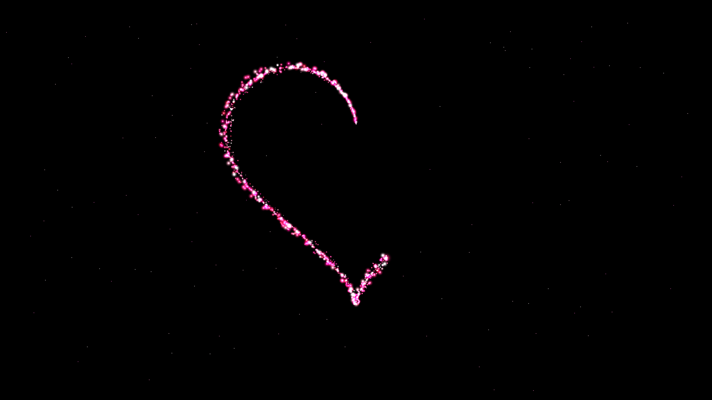
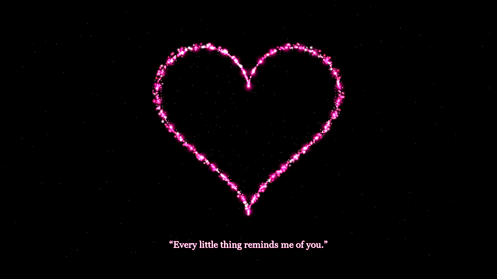

# ✨ A Thousand Little Hearts — Cinematic Live Particle Drawing in Python

<div align="center">


<p align="center">
  <b>Watch an invisible artist progressively draw a radiant, glowing heart in the darkness, particle by particle.</b><br>
  <i>Rendered in real-time at 60 FPS using Python, Pygame, and NumPy. Not a pre-rendered video or GIF.</i>
</p>

</div>

---

## 🌹 Visual Showcase

<div align="center">

### 1. The Drawing Phase (t = 3.0s)
*The lead artist spark sweeps along the mathematical heart curve, trailing silky light and birthing hundreds of glowing diamond particles.*



<br><br>

### 2. The Completed Masterpiece & Message (t = 9.5s)
*The heart beats with a natural resting pulse, casting an ethereal magenta aura, shedding drifting stardust, and revealing the romantic quote.*



</div>

---

## 📖 Overview

**A Thousand Little Hearts** is a creative coding project that transforms mathematical curves and particle physics into a cinematic digital artwork. 

Over a deterministic **10-second timeline**, thousands of glowing particles emerge from darkness, trace an arc-length normalized heart path, converge using damped spring dynamics, synchronize into an organic physiological heartbeat, and present the romantic message:

> <p align="center"><b>“Every little thing reminds me of you.”</b></p>

---

## 🌟 Key Features

- **100% Procedural & Real-Time**: Runs live directly inside the Pygame engine at 60 FPS. Every particle position, velocity, and shimmer is computed on the fly.
- **Arc-Length Parameterized Geometry**: Solves the non-uniform drawing speed of parametric curves, ensuring the artist's brush glides at a constant linear velocity.
- **Physical Optical Bloom**: Multi-layer Gaussian radial glow discs rendered with **premultiplied alpha** and hardware-accelerated additive blending (`pygame.BLEND_ADD`), eliminating rectangular tile artifacts.
- **Damped Spring Mechanics**: Awakened particles burst outward with kinetic energy and fluidly converge to their curve anchors via critically damped harmonic motion:
  $$\vec{a} = k \cdot (\vec{P}_{\text{target}} - \vec{P}) - c \cdot \vec{v}$$
- **Physiological "Lub-Dub" Heartbeat**: Simulates a resting cardiovascular pulse (~52 bpm) with a dual-peak systolic expansion and diastolic rebound, harmonically modulating particle positions and glow radius.
- **Romantic Color Palette**: Tailored gradients of Neon Pink (`#FF2D82`), Crimson Red (`#E11441`), Rich Magenta (`#D20073`), Soft Rose (`#FFA0BE`), and White-Pink highlights (`#FFF0F8`).
- **Responsive 16:9 Canvas**: Native 1920 × 1080 resolution automatically scaled to fit any monitor resolution cleanly via `pygame.SCALED`.
- **Dual Delivery**: Includes both the high-performance **native Python desktop app** and a companion **HTML5 Canvas web viewer**.

---

## ⏱️ Animation Timeline (10 Seconds)

| Time Window | Phase | Visual & Kinetic Description |
| :---: | :--- | :--- |
| **0.0s – 1.0s** | **The First Spark** | Pure blackness. At 0.3s, a tiny glowing pink spark awakens near the upper cleft of the future heart, shedding delicate glowing embers and breathing gently. |
| **1.0s – 4.5s** | **The Heart Is Drawn** | The lead spark traces the curve in a single continuous stroke: *upper-left arch $\to$ left curve $\to$ sharp bottom tip $\to$ right curve $\to$ upper-right lobe $\to$ cleft*. Over 1,400 diamond particles awaken, burst forward, and settle into place with decaying motion trails. |
| **4.5s – 6.5s** | **The Heart Comes Alive** | The loop closes cleanly. Subtle volumetric interior stardust awakens within the body of the heart, and an ethereal magenta background aura softly blooms. |
| **6.5s – 8.0s** | **The Heart Pulses** | The completed heart begins beating with a natural resting heartbeat rhythm (~52 bpm). Particles expand outward on each beat, and delicate stardust dissolves into the dark void. |
| **8.0s – 10.0s** | **The Romantic Message** | `“Every little thing reminds me of you.”` smoothly fades in centered beneath the pulsing heart with a soft pink contour glow. |
| **10.0s+** | **Eternal Glow** | The finished masterpiece remains alive on screen, gently pulsing with drifting stardust until you restart or exit. |

---

## ⌨️ Controls

The interface remains 100% minimal and cinematic — all controls are invisible during playback:

| Key | Action |
| :---: | :--- |
| <kbd>Space</kbd> | Restart the 10-second animation from the opening spark |
| <kbd>R</kbd> | Restart animation immediately |
| <kbd>F</kbd> | Toggle Fullscreen / Windowed mode |
| <kbd>Esc</kbd> | Exit the application cleanly |

---

## 🚀 Getting Started

### 1. Prerequisites

- Python 3.10, 3.11, 3.12, 3.13, or 3.14
- Git

### 2. Clone the Repository

```bash
git clone https://github.com/Hxni786/Python-Heart-Animation.git
cd Python-Heart-Animation
```

### 3. Install Dependencies

```bash
pip install -r requirements.txt
```

*(Or manually: `pip install pygame-ce numpy`)*

### 4. Launch the Native Desktop Application

```bash
python main.py
```

---

## 🌐 Optional Browser Web Viewer

If you prefer to preview the animation directly in a web browser, a companion HTML5 Canvas viewer is included in [`web_viewer/`](web_viewer/):

```bash
python -m http.server 8000 --directory web_viewer
```
Then navigate to: **[http://localhost:8000](http://localhost:8000)**

---

## 📂 Project Architecture

```
Python-Heart-Animation/
├── main.py              # Main real-time Pygame loop (1920x1080 @ 60 FPS) & event handling
├── particle.py          # Particle system, lead artist spark, springs, trails & stardust
├── heart_path.py        # Mathematical parametric heart equations & arc-length engine
├── effects.py           # Optical bloom cache with premultiplied alpha, heartbeat & text
├── requirements.txt     # Python package requirements (pygame-ce, numpy)
├── README.md            # Project documentation & visual showcase
├── .gitignore           # Git ignore rules for Python & IDE files
├── render_frame_3_0s.png# High-resolution capture of the live drawing phase
├── render_frame_9_5s.png# High-resolution capture of the completed masterpiece
├── web_viewer/
│   └── index.html       # Standalone HTML5 canvas browser companion
└── assets/
    └── fonts/           # Local typography assets (offline, zero external downloads)
        ├── romantic_serif.ttf
        └── romantic_light.ttf
```

---

## 📐 Mathematical Formulation

The heart perimeter is governed by the following parametric system:

$$\begin{aligned}
x(t) &= -16 \sin^3(t) \\
y(t) &= -(13 \cos(t) - 5 \cos(2t) - 2 \cos(3t) - \cos(4t))
\end{aligned}$$

where $t \in [0, 2\pi]$.

To ensure smooth, constant drawing velocity across lobes and tips, the curve is discretely sampled ($N=4,000$) and reparameterized by normalized cumulative arc length $u \in [0, 1]$:

$$s(u) = \int_0^u \sqrt{\left(\frac{dx}{dt}\right)^2 + \left(\frac{dy}{dt}\right)^2} dt$$

---

## 👤 Author

**Syed Hassan Dildar**
- GitHub: [@Hxni786](https://github.com/Hxni786)
- Repository: [Python-Heart-Animation](https://github.com/Hxni786/Python-Heart-Animation)

---

## 📄 License

This project is licensed under the MIT License — see the [LICENSE](LICENSE) file for details.
